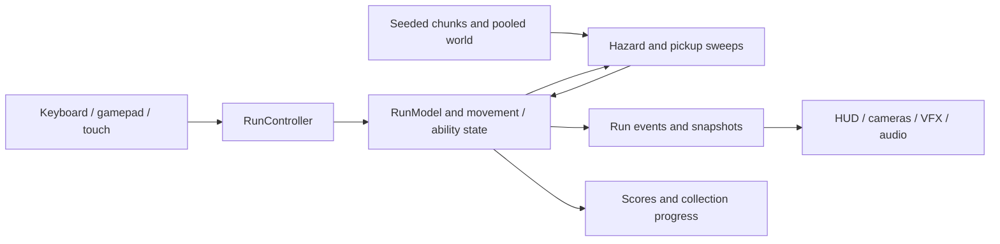

# Architecture

The project separates run rules from Unity orchestration and presentation. Domain classes own movement, lives, rewards, resources, and ordered state transitions. Unity-facing systems handle scene references, input, colliders, and rendering.

## Course geometry and world lifetime

The course uses seeded analytic bends rather than retaining a history of generated positions. Each sampled frame supplies tangent, right, up, curvature, and a metric scale. The longitudinal coordinate remains the score coordinate; it is not exact centreline arc length.

[CylinderCourse.cs](../samples/unity/CylinderCourse.cs) shows how course-space positions become world positions. Origin subtraction happens in double precision before values are converted to local floats, avoiding subtraction of large, already-rounded world coordinates. The curvature and metric bounds are documented in the source.

The private runtime streams 500-unit chunks with a 3,000-unit lookahead. It caps the active working set at eight chunk slots and 344 pooled hazards, then rebases the origin after 6,000 units. Chunk generation reserves a route corridor and limits candidate placement attempts. Querying appearance variation uses a separate seed stream, so changing the sky does not consume gameplay randomness.

## Movement, clocks, and collision order

RunModel commits simulation intervals and splits them at important transitions. Movement, collision handling, ability expiration, recovery, and rewards therefore share an authoritative order. Gameplay notifications carry run/event identifiers for presentation consumers.

[DashController.cs](../samples/unity/DashController.cs) holds three charges, spends one per activation, and recharges them sequentially. Its quintic displacement has zero speed and acceleration at the endpoints. Partial intervals integrate the trajectory instead of applying an instantaneous teleport. The private collision integration checks the resulting path and moving hazard poses.

[PickupState.cs](../samples/portable/src/PickupState.cs) tracks Rocket, Hourglass, and Laser against a monotonic active-play clock. Movement scaling is separate from resource expiry: slowing the craft does not automatically extend every powerup. The caller owns clock advancement and pause; the sample itself is not a complete game loop.

## Progression and presentation

UpgradeService maintains eligibility and the upgrade ledger, with major introductions, minor choices, and craft replacement summaries. Previewing an upgrade must not mutate future choices. Score eligibility and permanent collection access are separate from the current run's craft eligibility.

Snapshots and run events supply the HUD, cameras, effects, and audio. Menus support keyboard/controller navigation; touch ownership is handled through the input layer. Craft models remain visual assets while the physical gameplay envelope stays governed by the run data.

[SkySelection.cs](../samples/portable/src/SkySelection.cs) is a compact example of the boundary between presentation and rules. It produces deterministic shuffle bags, prevents adjacent repeats, and supports distant queries without replaying all earlier selections. The constructor accepts the cadence: the current game explicitly uses ten completed levels per sky change, while the class retains a default of 35 for historical callers.

## Public source scope

The five published source files are byte-for-byte copies from the delivered private source baseline. The portable harness runs real selection and pickup behavior without Unity. The Unity examples remain readable production files and require UnityEngine; they are not included in the portable build. Full scene orchestration, generation, collision integration, and licensed assets remain in the private project.

[Source origins and verification instructions](../samples/README.md) · [Recorded full-project checks](VERIFICATION.md)
