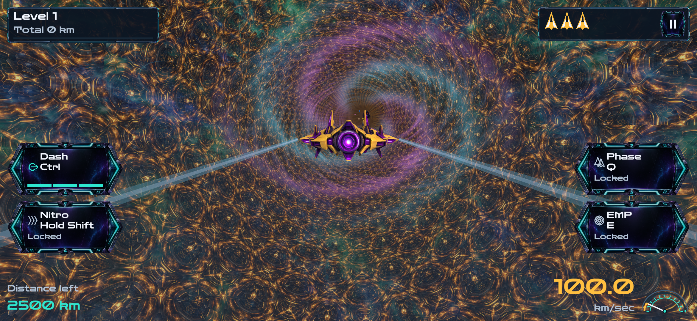
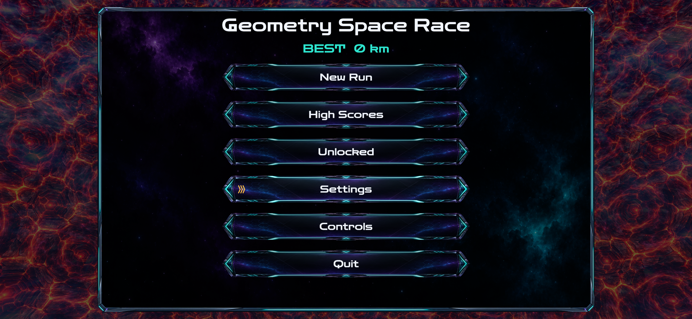
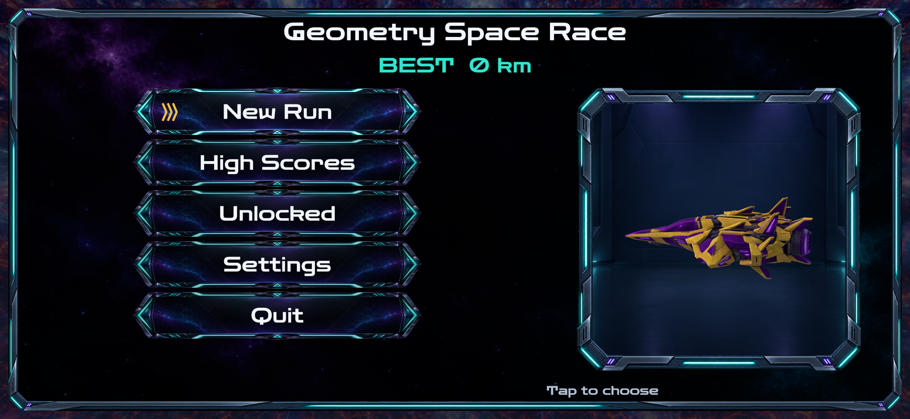
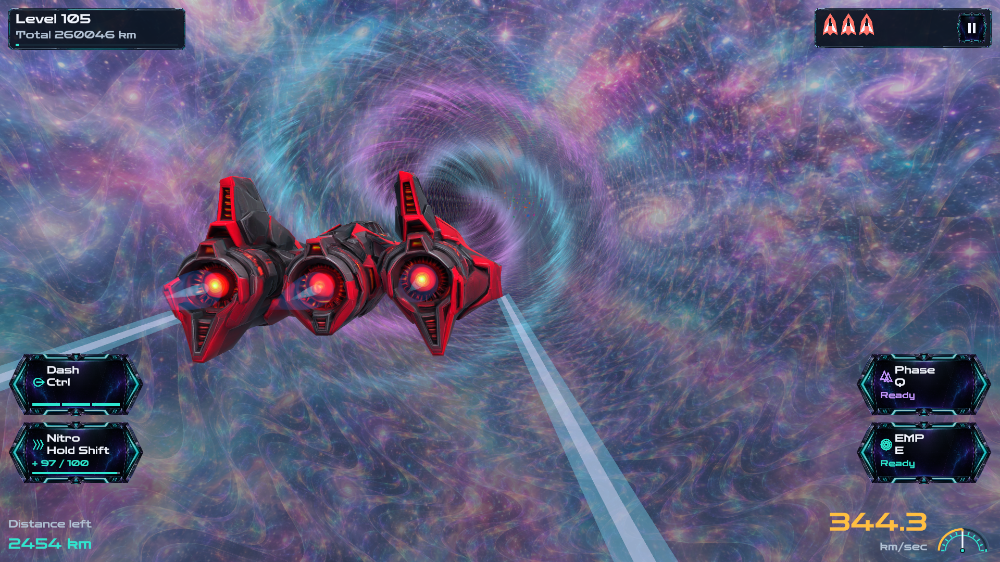

# Gameplay and screenshots

Geometry Space Race is a single-player arcade flight game. The goal is to keep a run alive as spacecraft speed, upgrades, and obstacle density progress.

## Run loop

1. Start with three lives and the yellow spacecraft.
2. Steer through the tunnel, using charged Dash moves and available abilities to avoid hazards.
3. Complete 2,500-unit levels, install major modules, and choose eligible minor upgrades.
4. Reach the white craft at level 35 and red craft at level 70. Completed progression eventually reaches a capped endless state.
5. Recover after nonfatal collisions; restart after the last life is lost. Only collected Hearts add lives.

Nitro uses fuel, Phase temporarily changes collision interaction, and EMP clears nearby hazards. Rocket temporarily doubles normal cruise speed, Hourglass slows movement while resource clocks continue on active-play time, and Laser charges before clearing hazards ahead. Different effects retain their own timing and cancellation rules.

The camera cycles through Chase, Close, First person, Nose, and Distant. Desktop controls include keyboard/gamepad input and rebinding; the Android layout provides touch steering and ability actions. Settings include motion, camera, display, and audio options.

## Current flight and title

These are unchanged in-engine captures recorded during 0.5.1 verification. They show the actual title and flight presentation. They are staged verification captures, not a continuous gameplay recording.

## Touch layout and late-game craft

The following captures come from the preceding 0.5 verification. The touch menu was captured in a simulated phone layout inside Unity. The red-craft image stages level 105 and maximum-left steering to inspect camera framing. Neither establishes physical Android execution or a naturally completed level-105 run.

Version 0.5.1 subsequently adjusted Chase distance, tunnel transparency, and Windows menu spacing. See the [capture provenance](../assets/screenshots/provenance.json) for original file paths and hashes.
